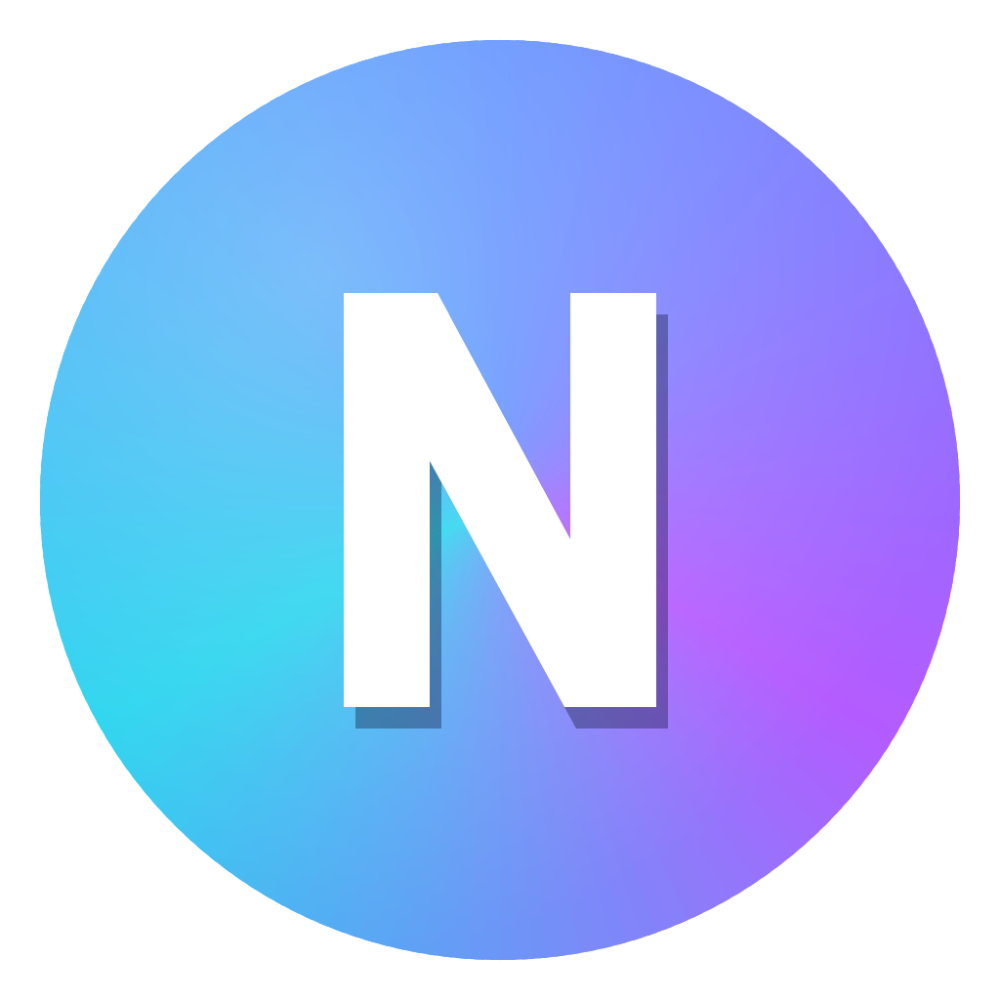
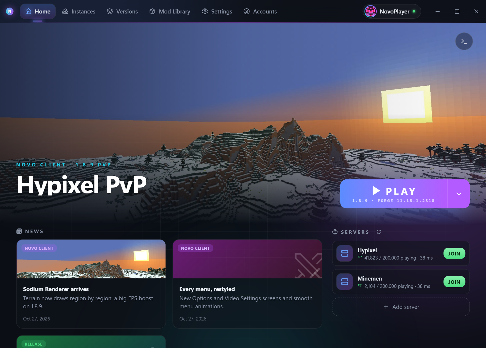
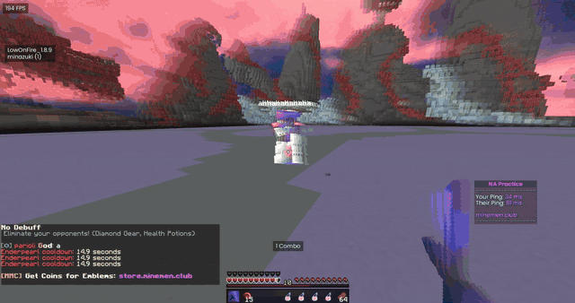
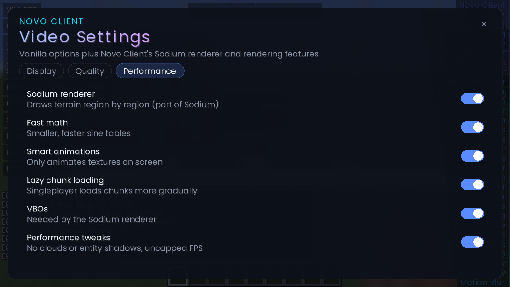
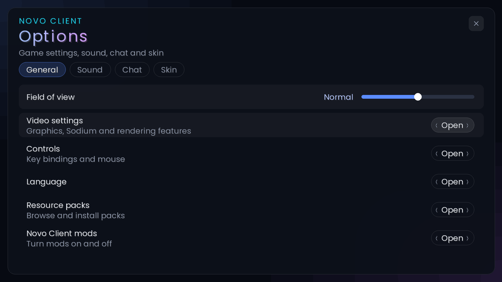
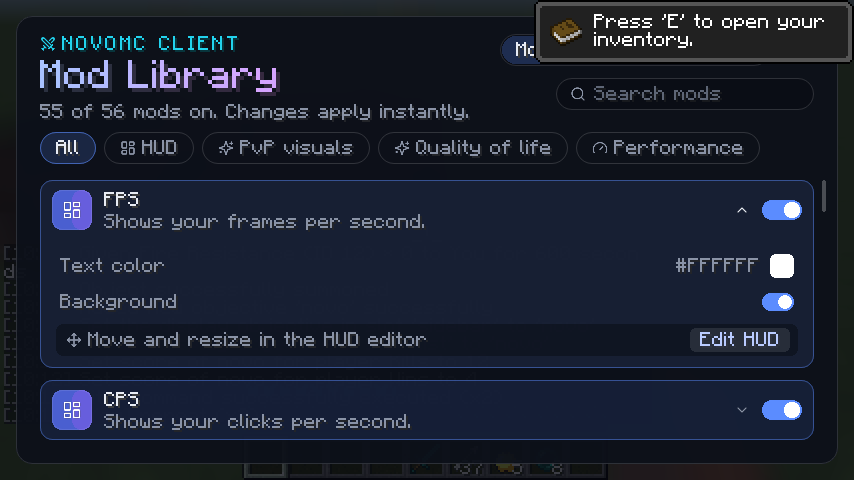
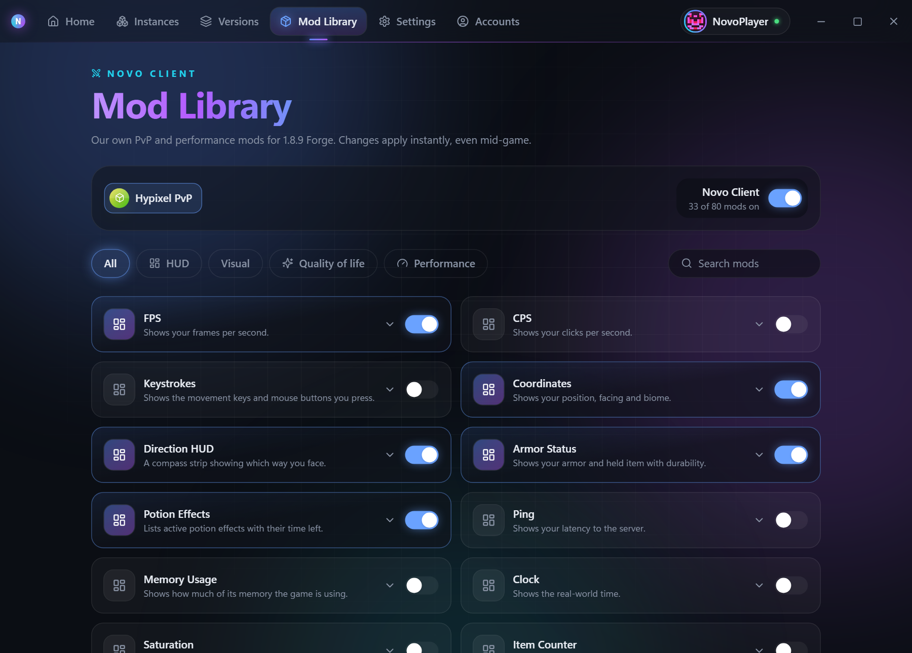
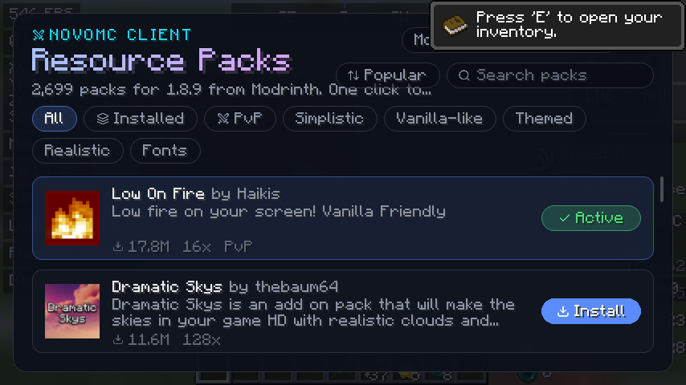
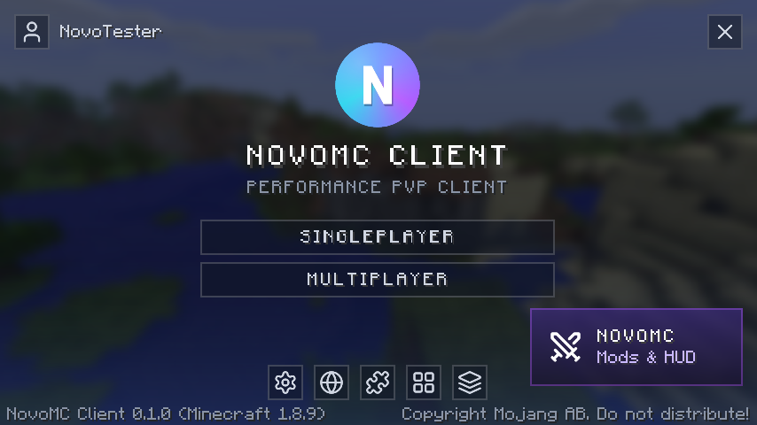
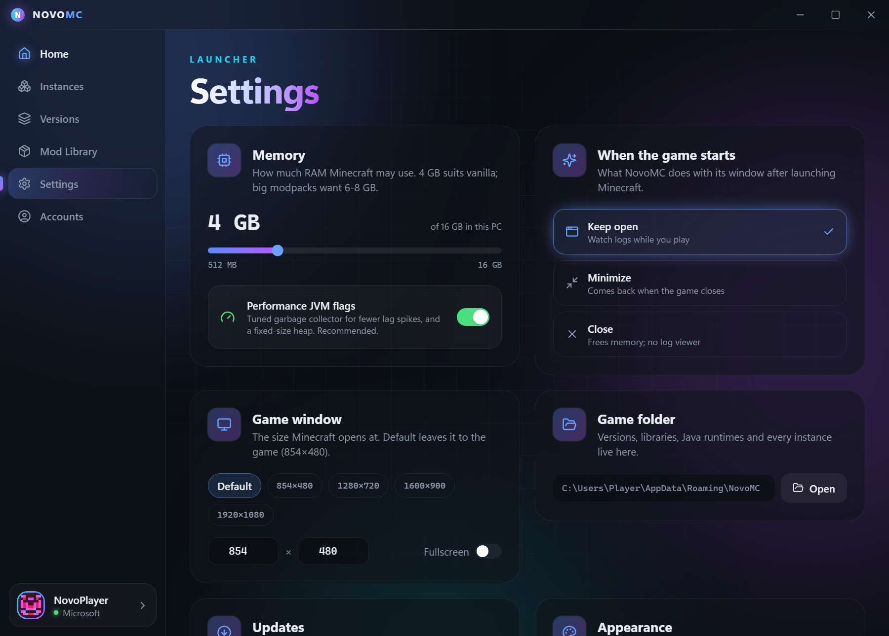

# Novo Client

**Sodium, re-forged for 1.8.9 — combined with OptiFine's features, custom-made.**

A 1.8.9 Forge PvP client and launcher: Sodium's renderer ported to Forge, OptiFine-style features rebuilt
from scratch, 80 built-in mods, thousands of resource packs, one click to play.

### [⬇ Download Novo Client for Windows](https://github.com/foreski/NovoMC/releases/latest)

---

## 💡 What is Novo Client?

| | |
| --- | --- |
| 🟦 **Sodium, re-forged** | [Sodium](https://github.com/CaffeineMC/sodium)'s chunk renderer, ported to Minecraft 1.8.9 Forge. Terrain draws region by region in a handful of GPU calls instead of one per chunk. |
| 🟪 **OptiFine features, custom-made** | Connected Textures, Custom Sky, Smart Animations, Fast Math, Lazy Chunk Loading, Better Grass and Better Snow, written by us from scratch (no OptiFine code), so they work right alongside Sodium. |
| ⚔️ **A full PvP client** | 80 built-in mods (HUD, keystrokes, 1.7 animations, freelook, zoom and more), all toggleable in-game. |
| 🚀 **Its own launcher** | One-click play: Novo Client installs Minecraft, Forge and Java for you, and keeps itself updated. |

Sodium's speed and OptiFine's features on 1.8.9, in one package built for PvP.

Novo Client isn't affiliated with CaffeineMC (Sodium) or OptiFine. The Sodium port stays under Sodium's GNU LGPL v3;
the OptiFine-style features are our own code.

## 🎬 See it in action

  

A real duel on Novo Client 1.8.9 · <a href="docs/media/novomc-showcase.mp4">▶ Watch the full 50-second clip</a>

## ⚡ Double your FPS

Novo Client ships its own performance mods for 1.8.9: no OptiFine, no third-party mod jars.

- **Sodium Renderer**, our port of [Sodium](https://github.com/CaffeineMC/sodium)'s chunk renderer to 1.8.9:
  compact vertices packed into shared region buffers, drawn with one call per region instead of one per chunk
  (needs OpenGL 3.3, otherwise vanilla rendering is used).
- **OptiFine-style options, rebuilt by Novo Client**: Fast Math, Smart Animations, Lazy Chunk Loading, Connected
  Textures (seamless glass out of the box, plus CTM from resource packs), Custom Sky (pack skyboxes),
  Better Grass and Better Snow. Inspired by [OptiFine](https://optifine.net); none of its code is used.
- **No vanilla menus**: Novo Client's own Options and Video Settings screens, and every other menu (servers, worlds,
  controls, language, dialogs) drawn with Novo Client's buttons, sliders, fields, lists and backdrop.
- **Smart culling** skips far-away mobs, armor stands, dropped items, chests, signs, skulls and banners.
- **Particle limiter** caps particle spam in fights and drops particles you can't see anyway.
- **Uncapped frame rate**, VBO rendering, no entity shadows and no clouds, switched on for you.
- **Patcher-style fixes**: borderless fullscreen, camera parallax fix, inventory that stays put with potions, frozen texture animations.
- **Tuned Java flags** for short, smooth garbage-collection pauses instead of lag spikes.

In our lobby stress test (400 armor stands, ~1,900 chests and skulls, constant particles) Novo Client went from
**126 FPS to 259 FPS: +105%**. Every optimization can be switched off if you prefer vanilla.

  
  

## 🎮 80 mods, built in

Everything a PvP player wants, ready the moment you join a server. Toggle mods and change their
settings in-game (Right Shift) or from the launcher, and drag any HUD element exactly where you want it.

| HUD | PvP visuals | Quality of life |
| --- | --- | --- |
| FPS, CPS, Keystrokes | 1.7 animations | Freelook & Snaplook |
| Armor Status, Potion Effects | Hit Color, Hurt Cam | Zoom, Toggle Sprint/Sneak |
| Coordinates, Direction HUD | Block Outline, Hitboxes | Nick Hider |
| Ping, Clock, Memory | Item Physics, 2D Items | Custom Scoreboard & Tab list |
| Combo Counter, Reach Display | Motion Blur, Menu Blur | Chat tweaks, Titles, Boss Bar |
| Waypoints with beams | Hit Sounds, Low Health Warning | Auto GG, Auto Text hotkeys, Screenshot manager |
| Mod List, Loading Screens | Dynamic Lights | Hypixel Quickplay, Requeue & Quick Report |

  
  

## 🎨 Thousands of resource packs, in-game

Browse every Modrinth resource pack that works on 1.8.9 (about 2,700 and counting) without leaving
Minecraft. Search, sort by popular or newest, filter by PvP, Simplistic, Vanilla-like and more, then hit
**Install**: the pack downloads, gets checked and turns on immediately.

  

## 🚀 A launcher that stays out of your way

- **One-click play.** A big Play button with your instances one click away; Novo Client downloads the game, Forge and the right Java for you.
- **Live news** from the Novo Client team right on Home, with pictures.
- **Every Minecraft version**, straight from Mojang's servers and checked file by file.
- **Instances** with their own worlds, mods, packs, memory and Java. Duplicate one in a click.
- **Microsoft accounts** for online servers and Realms, with your real skin. Sign-ins are stored in
  Windows Credential Manager, never in plain files.
- **Quick-join servers**: your favorite servers on Home with live player counts and ping; one click
  launches straight into the server.
- **Discord Rich Presence** shows what you're playing and on which server.
- **Live console** with crash reports, so you can see what went wrong.
- **Your look, your language**: accent colors, and the launcher in English, Deutsch, Español, Français and Português.
- **Automatic updates**: Novo Client keeps itself up to date, and every update is cryptographically signed.

  
  

## 📥 Get started

1. **[Download the installer](https://github.com/foreski/NovoMC/releases/latest)** (`NovoMC_x.y.z_x64-setup.exe`).
2. Run it. If Windows SmartScreen shows a warning, click **More info → Run anyway** (the installer isn't code-signed yet).
3. Add your Microsoft account, create a 1.8.9 instance and press **Play**.

Requires Windows 10 or 11 (64-bit). Java is downloaded automatically.

## 🛡 Fair play

Novo Client is a visual and quality-of-life client, like the big-name PvP clients. Nothing automates your input
or shows information vanilla hides. Freelook can't be disabled by servers the way some clients allow, so
check a server's rules before using it there.

## 🛠 Build from source

Novo Client is a Tauri 2 (Rust) + React launcher and a Forge 1.8.9 mod. See
**[docs/DEVELOPMENT.md](docs/DEVELOPMENT.md)** for setup, build commands and the project layout.

The Sodium Renderer (`client-mod/src/main/java/com/novomc/client/sodium`) is ported from Sodium 0.5 by
JellySquid and the CaffeineMC contributors and stays under the
[GNU LGPL v3](client-mod/src/main/resources/com/novomc/client/sodium/LICENSE-SODIUM.txt).

---

Novo Client is not an official Minecraft product and is not approved by or associated with Mojang or
Microsoft. Minecraft is a trademark of Mojang AB. Resource packs are provided by their authors through
Modrinth.
