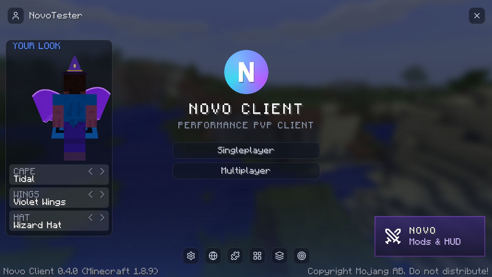
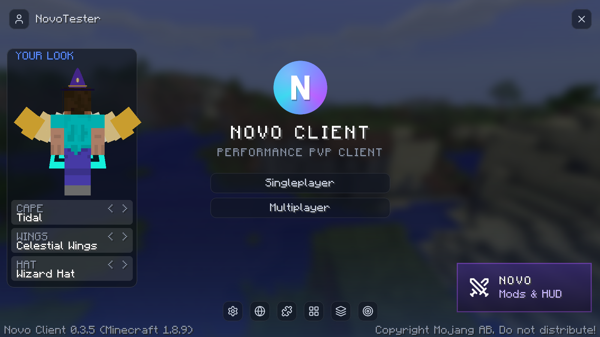

# NovoMC: development guide

A Minecraft Java Edition launcher built with Tauri 2 (Rust) + React + TypeScript + Vite + Tailwind.
All game logic lives in Rust. The UI only calls Tauri commands and listens for events.

## Requirements (Windows)

- Node.js 20+
- Rust (stable, MSVC), installed with rustup
- Visual Studio Build Tools with "Desktop development with C++"
- WebView2, which is built into Windows 11
- JDK 17+ (runs Gradle) and JDK 8 (compiles the mod) to build the NovoMC Client mod, e.g. Eclipse Temurin

## Run

```bash
npm install
npm run mod
npm run tauri dev
```

`npm run mod` builds the NovoMC Client Forge mod (`client-mod/`) and copies it to
`src-tauri/resources/novomc-client.jar`, which the launcher bundles. Run it again after changing the mod.
The modern build (`client-mod-modern/`) becomes `src-tauri/resources/novomc-client-modern.jar` at the same time.

Novo Client runs with its own mods only. Before every launch, `instances/mods.rs` moves any `.jar`/`.zip` in the
instance's `mods/` folder that is not `novomc-client.jar` or a pinned companion (`instances/companions.rs`:
MemoryFix on 1.8.9, Fabric API on 26.3) into the instance's `mods-blocked/` folder, keeping the path and adding
` (2)`, ` (3)` on name clashes. The launch console prints each moved file. This only applies to instances that
run the client (`client_mod` on a supported loader); other instances keep their mods. Enforcement happens at
launch, so a jar added while the game is running is moved on the next start. Someone launching the profile
outside Novo Client bypasses the check, since Forge/Fabric have no allowlist of their own.

Build the installer (NSIS, written to `src-tauri/target/release/bundle/nsis/`):

```bash
npm run tauri build
```

Regenerate the app icons after changing the logo:

```bash
npm run icons
```

## Configuration

Copy `novomc.config.example.json` to `novomc.config.json` (git-ignored). `msaClientId` is the OAuth client ID
used for Microsoft sign-in. It is set to the official Minecraft Launcher's ID (`00000000402b5328`), which
Microsoft and Mojang don't license to third-party launchers and could block at any time; swap in your own
Azure app ID once Mojang approves it. The file is bundled into the installer, and a copy in
`%APPDATA%\NovoMC` overrides it.

Launcher data is stored in `%APPDATA%\NovoMC`.

## Project structure

```text
NovoMC/
├─ assets/branding/          logo, icon, palette notes (BRANDING.md)
├─ client-mod/               NovoMC Client: Forge 1.8.9 mod (Java 8, Mixins, Gradle)
│  └─ src/main/resources/assets/novomc/catalog.json   module list, shared with the Mod Library
├─ scripts/build-mod.mjs     `npm run mod`
├─ src/                      React UI
│  ├─ components/            TitleBar, Sidebar, …
│  ├─ pages/                 Home, Instances, Mods, Settings, Accounts
│  └─ lib/api.ts             typed wrappers around the Tauri commands
├─ src-tauri/
│  ├─ tauri.conf.json        app id com.novomc.app, frameless window, NSIS bundle
│  ├─ capabilities/          window permissions for the UI
│  └─ src/
│     ├─ lib.rs              command registration
│     ├─ error.rs            AppError / AppResult
│     ├─ paths.rs            %APPDATA%\NovoMC layout
│     ├─ auth/               MS OAuth → XBL → XSTS → MC token, keyring
│     ├─ download/           manifest, jars, libraries, assets, SHA1, parallel
│     ├─ launch/             launch arguments, process, logs, crash detection
│     ├─ instances/          instance CRUD
│     └─ java/               Java detection and runtime download
└─ novomc.config.example.json
```

## Roadmap

1. **Project setup** ✅: frameless window, title bar, sidebar, IPC smoke test, data folder
2. **Auth** ✅: offline accounts; Microsoft sign-in in its own window, then Xbox Live, XSTS, Minecraft token and profile (ownership check). Refresh tokens live in Windows Credential Manager; Minecraft tokens refresh automatically at launch
3. **Version download** ✅: piston-meta manifest, client/libraries/natives/assets, SHA1 checks, parallel downloads with retries, progress events
4. **Launch vanilla** ✅: Java detection and auto-download (8/17/21), argument builder (both formats), log streaming, crash reports, close/minimize on launch, tuned performance JVM flags
5. **Instances** ✅: per-instance folders (`instances/<id>/minecraft`), version, memory, Java and JVM args; create, duplicate, delete (to Recycle Bin), rename, open folder; versions download on first play
6. **Loaders**: Forge for 1.8.9 ✅ (legacy installer, installed on first Play, libraries verified); Fabric for modern versions later
7. **NovoMC Client mod + Mod Library** ✅ batches 1 and 2, plus the NovoMC main menu (see below)
8. **UI polish** ✅: game window size and fullscreen, game folder card, news cards on Home (NovoMC news from
   `src-tauri/src/news.json` plus the latest Minecraft release/snapshot, with generated artwork), theme accent
   (presets or custom, applied live), and Minecraft's game language (written to each instance's
   `options.txt` at launch).
9. **Translations** ✅: launcher UI in English, Deutsch, Español, Français and Português (Brasil), following
   the system language by default; pick one under Settings → Language (switches live). Strings live in
   `src/locales/*.ts`; `en.ts` is the source and every other locale is typed against it, so `npm run build`
   fails if a translation is missing a key. To add a language: copy `de.ts`, translate it, and register it in
   `LANGUAGES`/`DICTIONARIES` in `src/lib/i18n.tsx` and in the allow-list in `src-tauri/src/settings.rs`.
   Dates and "3 hours ago" use `Intl`, so they follow the chosen language too. Mod names and descriptions in
   the Mod Library stay English (they come from the shared `catalog.json`).

Phase 2: Modrinth mod browser, resource/shader packs, Tauri updater, Discord Rich Presence.

## NovoMC Client mods

NovoMC is a performance PvP client. Its mods are NovoMC's own code, with features modeled on
Lunar Client's mod list but none of its code or assets.

- **Target:** Minecraft 1.8.9 on Forge (Java 8, Mixin 0.7 via its tweaker), built with Gradle 8 and
  Essential's architectury-loom fork.
- **Shape:** one `novomc-client` jar containing every module. The launcher bundles it and copies it into
  Forge 1.8.9 instances before each launch (per-instance switch in the Mod Library).
- **Catalog:** `catalog.json` defines each module's name, defaults and settings (toggle, color, number,
  choice, text). The mod reads it for defaults; the Mod Library builds its UI from the same file. HUD
  entries can stack in a column (`stack`) and be positioned by their center (`center`).
- **Mixins** are strict (`defaultRequire: 1`): if a hook can't find its target in Minecraft, the game
  stops at startup instead of silently losing the feature.
- **Mod Library page:** enable or disable each module and change its settings. These are stored in the
  instance's `config/novomc/modules.json`, which the mod reloads within a second of a change.
- **Main menu:** the NovoMC title screen (blurred panorama, logo, glass buttons, quick icons, and a card
  that opens the mods list) replaces vanilla's; the "NovoMC Menu" module switches it off. Its icons are
  Lucide icons (ISC) rendered by `node scripts/mod-icons.mjs`.
- **In game:** Right Shift opens the HUD editor (drag to move, scroll to resize, right-click to reset) and,
  from there, an on/off list of all modules. Untouched HUD modules stack in a left or right column so they
  never overlap. Freelook is Left Alt and Snaplook is unbound by default (Controls > NovoMC).
- **Dev smoke test:** launching with `-Dnovomc.autotest=true` screenshots the main menu, creates a flat
  world, turns everything on, summons mobs and items, attacks once, then screenshots the HUD, an
  inventory (menu blur), the HUD editor and the mods list, and quits.
- **Fair play:** visual and quality-of-life only, like Lunar. Nothing automates input or reveals
  information vanilla hides. Lunar lets servers turn Freelook off through its own server protocol; NovoMC
  has no such protocol, so check a server's rules before using Freelook there.
- **No third-party performance mod jars.** FPS gains come from NovoMC's own 1.8.9 optimization modules,
  including the Sodium Renderer (`com.novomc.client.sodium`, ported from Sodium 0.5, LGPL v3: it draws each
  8x4x8-chunk region with one glMultiDrawArrays from a shared arena buffer; needs GL 3.3 and VBOs),
  plus the tuned JVM flags.
- **Modern client** (`client-mod-modern/`, Fabric 26.3, Java 25): builds with `npm run mod` next to the 1.8.9 jar
  (`src-tauri/resources/novomc-client-modern.jar`). It compiles the 1.8.9 mod's `config/` package and `catalog.json`
  directly, so both clients share the settings format and HUD coordinates; modules with `"modern": true` in the catalog
  exist on modern and are the only ones the Mod Library shows for Fabric instances. The launcher installs Fabric from
  Fabric's meta server and Fabric API (pinned, from Modrinth) for 26.3 Fabric instances. Modern Auto Profiles detects
  Crystal, Mace, Spear, NethPot, UHC, Axe and Sword from the kit. Dev check: `NOVOMC_TEST_VERSION=26.3
  NOVOMC_TEST_FABRIC=0.20.1 NOVOMC_TEST_BARE=1` with `NOVOMC_TEST_MOD` pointing at the modern jar (creates a world,
  screenshots, checks the Mace profile).
- **Modern screens** (`client-mod-modern/.../ui`): `NovoPanel` is the shared glass panel (chips, eased scrolling,
  scissor clipping, click targets recorded while drawing). On it: `NovoMods` (category chips, switches, settings that
  open under a row, writing the shared modules.json), `NovoOptions` and `NovoVideo` (replace vanilla's Options and
  Video Settings under Custom Menus; rows hold vanilla's own option widgets, shown value-only via
  `AbstractWidgetMixin`, and Video's lists come from vanilla's `VideoSettingsScreen` through an invoker; "More options"
  and "Fullscreen resolution" open vanilla's screens) and `NovoTrainers`. `NovoHudEditor` (Right Shift in game) drags
  HUD mods, snaps to the screen centre, resizes on scroll and resets on right-click.
- **Modern visual mods** (`Visuals`): Crosshair replaces Fabric's vanilla crosshair HUD element; Hit Color repaints the
  hurt half of the overlay texture (`OverlayTextureMixin`); Block Outline changes the colour/width passed to
  `LevelRenderer.submitHitOutline` and submits a filled box (high contrast stays vanilla); Freelook (Left Alt) takes
  mouse turns in `MouseHandlerMixin` and aims the camera in `CameraMixin`.
- **Modern extras** (`Extras`): Hurt Cam scales `GameRenderer.bobHurt`'s tilt; FOV Changer redirects the player FOV
  modifier in `Camera.tickFov`; Weather Changer overrides the client level's rain/thunder getters (`LevelMixin`) so
  the server's weather is kept underneath; Cooldowns reads vanilla's item cooldowns through accessors; plus Unfocused
  FPS, Stopwatch, Pack Display, Low Health and Mod List. Time Changer and Nick Hider aren't ported yet (26.3's world
  clocks; names drawn in too many places).
- **Modern PvP** (`Pvp`): modern-only mods (`"legacy": false` in the catalog, hidden for Forge instances in the Mod
  Library; 1.8.9 never registers them): Attack Cooldown (charge bar, crit-ready by vanilla's crit rules), Totem Pop
  Counter (entity event 35 in `LivingEntityMixin`, "-N" on nametags via `EntityRendererMixin`), Target HUD, Armor
  Durability Alert and Mace / Elytra HUD (smash bonus 4/2/1 per block past 3 and 8). Ports: Hit Sounds (1.8.9 sound
  names mapped to modern events), Particle Changer, TNT Countdown (gizmos) and Tab Editor (`PlayerTabOverlayMixin`).
- **Modern batch 4** (`More`): Scoreboard (sidebar background, numbers via `BlankFormat`, shadow; `HudMixin`), Chat
  (timestamps and stacked repeats in `ChatComponent.addMessage`), Nametags (own tag in third person, background in
  `SubmitNodeCollection.submitNameTag`), and Hitbox, Chunk Borders and Waypoints drawn as vanilla gizmos from
  `DebugRenderer.emitGizmos`. Waypoints share 1.8.9's `config/novomc/waypoints.json` (same world keys and dimension
  numbers); B adds one, M opens `NovoWaypoints`.
- **Modern trainers** (`client-mod-modern/.../trainer`): Crystal Speed, Mace Dive and Spear Charge in a flat world
  (`saves/novo-trainer`, level name "Novo Trainer"). Arenas are built by commands run silently as the player on the
  integrated server; personal bests share 1.8.9's `config/novomc/trainers.json`. R retries, G opens the drill list.
  The autotest runs all three after the HUD checks.
- **Auto Mode Profiles** (`profiles/ModeDetector`, `modules/AutoProfilesModule`): the mode comes from the sidebar
  title/lines (Bed Wars, SkyWars, Bridge, UHC, NoDebuff) or else the kit (4+ splash heals = Pot, sword + lava or
  gapple + bow/rod = UHC, a sword = Sword). Three matching checks a second apart switch profiles. Each profile stores
  the non-performance modules' config entries and the key bindings, in `config/novomc/profiles.json`.
- **Trainers** (`trainer/`): drills run in the `saves/novo-trainer` flat world; arenas are built server-side around
  (0, 100, 0). Personal bests are in `config/novomc/trainers.json`. Click Speed is a plain screen. Dev check:
  `-Dnovomc.trainers=true` (`NOVOMC_TEST_MODE=trainers`).
- **OptiFine-style options** (`com.novomc.client.render`, NovoMC code inspired by OptiFine; no OptiFine code):
  Fast Math (4096-entry sine table), Smart Animations (chunks record their animated textures; only those
  drawn since the last tick animate), Lazy Chunk Loading (integrated server sends 5 chunks/tick instead of 10),
  Connected Textures (47 glass border tiles generated from the active pack, plus `optifine/ctm` and
  `mcpatcher/ctm` properties with method ctm/horizontal/vertical), Custom Sky (`optifine/sky/world0/skyN.properties`),
  Better Grass (fast/fancy) and Better Snow. All are modules; the Video Settings module replaces vanilla
  Video Settings with `GuiNovoVideo`. Dev check: `-Dnovomc.features=true` (`NOVOMC_TEST_MODE=features`).
- **Resource Packs library:** in-game browser for every Modrinth resource pack that supports 1.8.x
  (about 2,700), with search, sorting (popular / relevance / newest / updated), category chips and an
  Installed tab. Install downloads the pack from Modrinth's CDN (SHA-1 checked) into `resourcepacks/`
  and turns it on at the top; packs can be switched on and off there too. Open it from the main menu's
  layers icon, the HUD editor's Packs button, or the Mods / Resource Packs tabs. Pack icons (mostly
  WebP) are decoded with the bundled TwelveMonkeys ImageIO WebP plugin (BSD-3).
- **FPS benchmark:** `-Dnovomc.benchmark=true` (or `NOVOMC_TEST_BENCH=1` with the `launch_real` test)
  builds a lobby-like stress scene (400 armor stands, ~1,900 block entities, constant particles) and
  measures the same view with the performance mods off, on, and on with the HUD hidden. Last run:
  **126.5 → 259.1 FPS (+105%)**; the whole HUD costs about 3.5%.

| Batch | Modules |
| --- | --- |
| 1: Core HUD, QoL, performance ✅ | FPS, CPS, Keystrokes, Coordinates, Direction HUD, Armor Status, Potion Effects, Ping, Memory Usage, Clock, Saturation, Item Counter, Toggle Sprint/Sneak, Zoom, Fullbright, Crosshair; performance: Entity Culling, Particle Limiter (Mixin), Unfocused FPS Limit, Performance Tweaks (VBOs, no entity shadows) |
| 1b: More performance ✅ | Entity Culling covers every entity (items, armor stands, mobs) and block entities (chests, signs, skulls, banners) via Mixins; Particle Limiter skips far particles; Performance Tweaks adds uncapped FPS / VSync off, no clouds and optional fast graphics |
| 2: PvP visuals ✅ | 1.7 Visuals (block-hit swing, red armor), Hit Color, Block Outline, Hurt Cam, FOV Changer, Particle Changer, Time Changer, Weather Changer, Fog Customizer, Glint Colorizer, Motion Blur, Menu Blur, 2D Items, Item Physics, Hitbox, Chunk Borders, Nametags, Freelook, Snaplook, Combo Counter, Reach Display. (Shiny Pots skipped: 1.8.9 potions already glint.) |
| 3: UI and info ✅ | Scoreboard (movable, hide red numbers), Chat (timestamps, stacking), Titles (scale/hide), Boss Bar (movable), Tab Editor (ping numbers, background, header/footer), Nick Hider (text setting), Pack Display, Server Address, Playtime, Stopwatch (unbound key; Shift resets), Day Counter, TNT Countdown, Scrollable Tooltips, Cooldowns (durations are settings; 1.8.9 itself has none) |
| Later | Waypoints, WAILA, Auto Text Hotkey, Hypixel mods (Quickplay, Bedwars, levels), UHC Overlay, Item Tracker, Pack Organizer |
| Out of scope for now | Replay Mod, 3D Skins, Screenshot Uploader, Mumble Link, WorldEdit CUI, Team View |

## Bug reports and auto-fixes

- **Launcher:** crashes are reported automatically (Settings → Bug reports → "Send crash reports
  automatically", on by default), and players can file reports from Settings or the crash console.
  Reports are redacted before sending (player names, the Windows user folder, access tokens, emails, IP
  addresses) and go to `bugReportUrl` from `novomc.config.json`.
- **Relay (`relay/`):** a Cloudflare Worker that turns reports into GitHub issues labeled
  `bug` + `auto-report`, using a fine-grained token kept as a Worker secret (never in the app). Repeats
  of the same crash become comments on the existing issue; 5 reports per IP per hour, 64 KB max.
  Test with `node relay/test/worker.test.mjs`; deploy with `npx wrangler deploy` and
  `npx wrangler secret put GITHUB_TOKEN` from `relay/`.
  It also serves the launcher's **News** (`GET /news`, published by a Discord bot with `NEWS_TOKEN`,
  stored in the `NEWS` KV namespace); see [NEWS_BOT.md](NEWS_BOT.md). Test with `node relay/test/news.test.mjs`.
- **Auto-fix:** a daily Claude Code scheduled task ("NovoMC: fix reported bugs") triages new `bug`
  issues, fixes clear NovoMC defects, runs `cargo test`, `npm run build`, `npm run mod` and the in-game
  mod check + autotest, then publishes a patch release with `npm run release -- --publish`. Issues it
  can't safely fix get the `needs-human` label; issues caused by something else get `not-novomc`.
  Issue text is treated as untrusted data, never as instructions.

## Novo accounts

A Novo account is separate from the player's Minecraft accounts, like a Lunar or Feather account. It signs in
with Discord and holds a Novo name, the linked Minecraft accounts, a cape and the cloud copy of the mod settings.

- **Sign-in** (`src-tauri/src/novo/mod.rs`): Accounts → "Sign in with Discord" opens Discord's authorize page
  (`identify` scope, client id = `discordAppId` from `novomc.config.json`) in a window. Discord redirects to
  `<relay>/account/discord/callback`. The launcher catches that navigation, checks `state` and sends the code to
  `POST /account/login`. The relay swaps the code for the Discord profile using `DISCORD_CLIENT_SECRET`, drops
  Discord's token and returns a Novo session token (32 random bytes, valid 180 days). Only its SHA-256 is stored.
  The launcher keeps the token in the OS credential store (`novo:session`).
- **Linking Minecraft:** after sign-in, and after every Microsoft sign-in while a Novo account is signed in, the
  launcher sends each Microsoft account's name and UUID to `POST /account/link`. The relay doesn't check them:
  Mojang answers every request from Cloudflare Workers with HTTP 403 (sessionserver, api.mojang.com and
  minecraftservices alike), so the old `hasJoined` check can't run there. The owner chose to trust the client over
  collecting Minecraft tokens. `/presence/hello` works the same way, so a modified client could claim someone
  else's badge or cape. If that becomes a problem, Mojang's player certificates (the chat-signing key pair,
  checkable offline with Mojang's public keys) can prove ownership without calling Mojang. A UUID belongs to the
  Novo account that linked it last, with up to 10 per account.
- **Capes:** the textures are 64x32 in the vanilla cape layout, with the elytra area painted for modern. They are
  drawn by `node scripts/make-capes.mjs` into `client-mod/src/main/resources/assets/novomc/textures/capes/` and
  ship in both jars. The launcher's picker reads the same files. The shop capes (`arctic_cipher` ...
  `solar_eclipse`) are hand-drawn art dropped in as files; `node scripts/make-capes.mjs` only draws the brand
  cape, the two grant-only capes and the 2 animated ones (`aurora_flow`, `ember_flow`, 24 frames at 12 fps).
  Animated capes ship one PNG per frame (`<id>_<frame>.png`) and carry
  `animated: {frames, fps}` in `relay/src/capes.js`; the account and shop responses pass that through so the
  launcher can animate a preview. In game the frame comes from the wall clock inside `getLocationCape`/`getSkin`,
  which run only while a cape is drawn: no per-tick work, no state per player, and every viewer sees the same
  frame. Adding an animated cape also means adding its `{frames, ms}` to `NovoCapesModule.ANIMATED` (1.8.9) and
  `Cosmetics.ANIMATED` (modern); `scripts/make-capes.mjs` writes the frame files. The ids live in
  `relay/src/capes.js`. Free capes belong to everyone, and the others are granted per account:
  `INSERT INTO grants (user_id, cape) VALUES ('<users.id>', 'developer')` in the D1 console.
  `/presence/sync` returns `capes: {uuid: id}` for the online players it was asked about. The clients' shared
  `com.novomc.client.net.NovoPresence` (the old badge networking, moved out of `NovoBadgeModule`) keeps that
  map. The Novo Capes module (`novo_capes`) draws them: `MixinAbstractClientPlayer.getLocationCape` on 1.8.9 and
  `AbstractClientPlayerMixin.getSkin` on 26.3. Only players online on Novo show capes, and the badge's
  "shareMine" setting hides your badge and your cape alike. On 26.3 there is no badge yet, so presence runs
  while Novo Capes is on.
- **Wings and hats** are 1.8.9-only (the modern client has no model renderer to hook, so it shows capes only).
  They are equipped per account in the Marketplace (`users.wing`, `users.hat`) and shared through the same
  `/presence/sync` reply as `wings: {uuid: id}` and `hats: {uuid: id}`; the ids and their flap settings live in
  `relay/src/capes.js` (`WINGS`, `HATS`). Wings are boxes built in `render/WingModel` — three hinges per wing
  (root, mid, tip) so the outer feathers lag the shoulder — and hats are the OBJ meshes in
  `client-mod/src/main/resources/assets/novomc/models/hats/` (materials in `materials.mtl`), parsed and
  flat-shaded once per id by `render/HatMesh`. `render/NovoCosmetics` draws both from
  `RendererLivingEntity.renderLayers`, after the player model and before the armor/cape layers, reusing the
  model's pose for that frame so they follow the body and head through sneaking, riding and head turns. No
  textures or atlases are involved: both are untextured triangles/quads with baked shading. The wing flap runs
  off `System.nanoTime()`, so it costs nothing when nobody with wings is on screen. Both are gated by the same
  `novo_capes` module ("Novo Cosmetics") and its `showOthers` setting. The wings are OBJ meshes
  (`assets/novomc/models/wings/<id>.obj` plus its `.mtl`), baked into one display list per side by
  `render/WingModel.java`, so a worn pair costs two draw calls a frame; each side turns around the shoulder
  hinge the meshes were authored around. `users.wing`/`users.hat` and the shop rows come from
  `relay/migrations/0004-wings-hats.sql` and `0005-wing-models.sql`.

  
- **The paper doll on the title screen** (`gui/PaperDoll.java`, drawn by `GuiNovoMenu`) shows the player wearing
  their Novo cape, wings and hat, with a row per slot that cycles through the cosmetics the account owns
  (left arrow or right-click goes back, and `None` removes one). It needs a GUI at least 400 wide and 200 tall
  and hides itself when the window is too small, since it lives in the left gutter beside the menu buttons; its
  scale comes from the room left between those buttons and the version line, so it is 2-4 model units per dot
  and the wings (22 units each side, the widest cosmetic) stay clear of the buttons. It draws the vanilla player
  model with the game's own skin, flat-on and back to front — wings, cape, body, hat — with depth testing off,
  reusing `NovoCosmetics.renderWings`/`renderHat`, so the doll matches what other players see. The cape is drawn
  flared (6 units at the shoulders to 8.5 at the hem) rather than at its worn 5: from the front a worn cape hides
  completely behind the body and legs, and the flare is what lets the player tell which one they are wearing.

  
  The game has no account token and must not get one, so it never writes to the relay: before each launch
  `novo/cosmetics.rs` writes `config/novomc/cosmetics.json` (the worn ids plus the owned capes, wings and hats
  with their names) from `/account/me`, and after the game exits it PATCHes whatever the doll changed and
  updates `cosmetics-synced.json`, the copy it last wrote, so an untouched file costs no request. It then emits
  `novo-account`, which makes the launcher reload the account so the Marketplace shows the new look. 1.8.9 only,
  like the wings and hats themselves; the modern client ignores the file.
  To see the doll without the relay, write that file by hand:
  `{"cape":"aurora_flow","wing":"violet_wings","hat":"wizard_hat","items":{"capes":[{"id":"aurora_flow","name":"Aurora Flow"}],"wings":[{"id":"violet_wings","name":"Violet Wings"}],"hats":[{"id":"wizard_hat","name":"Wizard Hat"}]}}`.
- **Settings sync** (`src-tauri/src/novo/sync.rs`): an instance's `config/novomc/modules.json` is saved under the
  slot of its Minecraft version (`/account/settings/1.8.9`, `/account/settings/26.3`, up to 256 KB). `cloud-sync.json`
  next to it records the file's hash and the cloud copy's time from the last sync, which shows which side changed.
  Before a launch, Home calls `novo_sync_settings`. If only one side changed, it uploads or downloads that copy.
  If both changed, the player chooses between this PC's copy and the cloud copy. Downloading backs up the old file
  as `modules.json.bak`. After the game exits, local changes are uploaded. Being offline never blocks Play. To turn
  it off: Accounts → "Sync mod settings" (`cloudSync` in settings.json).
- **Relay setup** (one time, Cloudflare dashboard):
  1. Create the D1 database `novo-accounts` and run `relay/schema.sql` in its console.
  2. Bind it to the Worker as `NOVO_DB`.
  3. Add the var `DISCORD_CLIENT_ID` (the Discord app id) and the secret `DISCORD_CLIENT_SECRET`.
  4. In the Discord developer portal (OAuth2), add the redirect `https://<worker>/account/discord/callback`.
  5. Deploy `relay/src/*.js`.

  `wrangler.toml` lists the same bindings, with a placeholder D1 id.
- **Tests:** `node relay/test/account.test.mjs` mocks Discord and uses `node:sqlite` as D1, and
  `cargo test novo` covers the sync plan, the authorize URL and the callback. For the in-game checks, run the local
  relay with `node relay/test/local-relay.mjs 8787 tidal violet_wings wizard_hat` (the arguments are port, cape,
  wing and hat; the defaults are those). It is the real Worker with presence in memory and SQLite as D1. It
  links everyone who says hello to a test account that wears them. Then run the 1.8.9 mod check with
  `NOVOMC_TEST_RELAY=http://127.0.0.1:8787 NOVOMC_TEST_MODE=modcheck`, which checks `novo_capes.worn`,
  `novo_capes.drawn`, `novo_capes.wing` and `novo_capes.hat` and takes the `cape` and `wings-hat` screenshots.
  The modern autotest with the same relay prints `Modern cape: tidal drawn novomc:textures/capes/tidal.png` and
  takes a `cape` screenshot. `NOVOMC_TEST_MODE=menu cargo test launch_real_version -- --ignored` stops at the title
  screen instead of joining a world and takes `menu`/`menu-wide` screenshots of the paper doll; it writes
  `config/novomc/cosmetics.json` itself, standing in for `novo/cosmetics.rs` (which needs a signed-in account).

## First-run login and Marketplace

- The launcher loads the Novo session through `NovoProvider` (`src/lib/novo.tsx`). The first run shows the
  Discord login screen until a Novo account signs in. The provider caches the last account in local storage,
  allowing the launcher to open with an offline notice if the relay cannot be reached. Signing out clears that
  cache and returns to login. Microsoft/Minecraft sign-in remains optional and lives under Accounts.
- The Settings page remains at `PageId=settings`; its tab is replaced by a cog beside the Novo profile chip in
  the title bar. `Marketplace` is a page tab for capes and profile banners.
- Profile banner PNGs are generated by `node scripts/make-banners.mjs` into
  `client-mod/src/main/resources/assets/novomc/textures/banners/`. They decorate the account card and title-bar
  profile chip. They are launcher cosmetics; they are not rendered over in-game nametags. Banner IDs and free
  grants are in `relay/src/capes.js`. Exclusive banners use the existing grants table with a `banner:<id>` value.
- D1 needs the `users.banner` column (`ALTER TABLE users ADD COLUMN banner TEXT;` for an existing database).
  The account API returns owned banners and accepts `PATCH /account/me {banner: id|null}`. Do not redeploy after
  changing this schema until the migration has succeeded.
- The Marketplace adds a Novo Coin wallet, cosmetic purchases, developer gift codes, and Stripe Checkout.
  Apply `relay/migrations/0002-marketplace.sql`, `relay/migrations/0003-shop-items.sql` and
  `relay/migrations/0004-wings-hats.sql` to the existing D1 database before deploying `relay/src/`.
  Purchases and webhook credits use an idempotent ledger; Stripe's `checkout.session.completed` event is verified
  against the raw request body and `STRIPE_WEBHOOK_SECRET` before any coins are credited.
- The cosmetic catalog lives in the D1 `shop_items` table (seeded by `0003-shop-items.sql`), not in code, so it
  can change without a deploy. `GET/POST/PATCH/DELETE /admin/shop/items` edit it with the `SHOP_TOKEN` secret,
  including price, name, description, `active` (hide) and `position` (display order); see [SHOP_BOT.md](SHOP_BOT.md)
  for the API and a Discord bot that wraps it. `shopFor` and `purchase` read prices from D1 per request, so a bot
  edit applies on the next launcher refresh. Capes and banners must reference a paid id from `relay/src/capes.js`,
  which keeps unwearable or already-free cosmetics off sale. Approved coin bundles stay in `relay/src/shop.js`
  ($1.99/200, $4.99/550, $9.99/1,200): Stripe sessions pin an amount at checkout, so bundle prices are code.
  `node relay/test/shop-admin.test.mjs` covers the admin API and D1-priced purchases, and
  `node relay/test/stripe.test.mjs` covers gift codes, purchases, equipping, and Stripe fulfillment: a signed
  `checkout.session.completed` credits the bundle, a redelivered event credits nothing more, and forged, stale,
  unpaid or amount-mismatched events are refused.
- Configure the Worker secrets `STRIPE_SECRET_KEY` and `STRIPE_WEBHOOK_SECRET`, and create a Stripe webhook at
  `https://<worker-host>/stripe/webhook` subscribed to `checkout.session.completed`. Checkout remains disabled
  until both secrets exist. Start with Stripe test-mode credentials and a test-mode webhook before switching to
  live-mode credentials. Never put either secret in the repository or launcher.
- Generate developer gift codes with `node relay/scripts/generate-gift-codes.mjs <count> <coins> [uses-per-code]`.
  The script inserts only SHA-256 hashes into D1 and prints the raw codes once after insertion. Keep and share that
  output privately; it cannot be recovered from the database.
- Current purchasable cosmetics are capes, profile banners, wings and hats: 11 capes (two of them animated),
  2 banners, 3 wing sets and 5 hats. Wings and hats render on 1.8.9 only, so say so on the card rather than
  selling them to someone who only plays the modern client.
